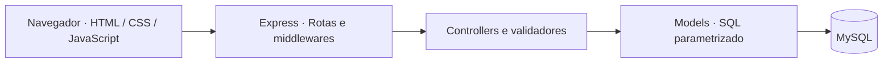

<div align="center">


# StudyUp

**Sua rotina acadêmica organizada em um só lugar.**

Uma aplicação web para transformar disciplinas, tarefas e prazos em uma rotina de estudos mais clara.


[](#apoio-de-inteligência-artificial)

[Equipe](#equipe) · [O projeto](#o-projeto) · [Funcionalidades](#funcionalidades) · [Tecnologias](#tecnologias) · [Execução local](#execucao-local)

</div>

---

<a id="equipe"></a>
## Equipe de desenvolvimento

**As pessoas por trás do StudyUp.**

Um projeto construído em colaboração, reunindo desenvolvimento, design, dados e infraestrutura.

| Integrante | Área de atuação |
| --- | --- |
| **Ícaro Lima** | Backend e segurança |
| **Erica Ferreira** | Design, usabilidade e testes |
| **Laura Almeida** | Frontend e organização da interface |
| **Lucas Pinheiro** | Banco de dados |
| **Iasmim Lobo** | Infraestrutura e deploy |

O StudyUp reúne o trabalho da equipe em interface, aplicação, dados, qualidade e infraestrutura. O [guia de apresentação](docs/apresentacao-equipe.md) organiza os temas de cada integrante para a demonstração do projeto.

---

<a id="o-projeto"></a>
## O projeto

Entre aulas, trabalhos e avaliações, acompanhar o que precisa ser feito pode ser tão difícil quanto estudar. O **StudyUp** nasceu como um projeto acadêmico para reunir essas informações em uma experiência simples: cadastrar disciplinas, organizar atividades e acompanhar os próximos prazos.

Cada estudante tem sua própria conta e seus próprios dados. O painel inicial, a lista de tarefas e a agenda diária compartilham as informações persistidas no MySQL, permitindo acompanhar a rotina desde o planejamento até a conclusão de cada atividade.

A identidade visual combina **verde, dourado e superfícies claras**, com estilos compartilhados e uma interface adaptável a diferentes tamanhos de tela.

<a id="funcionalidades"></a>
## Funcionalidades

| Recurso | O que você pode fazer |
| --- | --- |
| **Conta e acesso** | Criar uma conta, entrar, sair e consultar nome e e-mail no perfil. |
| **Disciplinas** | Cadastrar, editar e excluir disciplinas, com identificação por cor e contagem de tarefas pendentes. |
| **Tarefas** | Criar atividades com título, descrição, prazo, prioridade e disciplina opcional. Editar, excluir, concluir e reabrir. |
| **Busca e filtros** | Combinar busca, disciplina, prioridade, estado e período para encontrar atividades. |
| **Painel inicial** | Consultar totais, pendências, atrasos, conclusões e próximos prazos. |
| **Agenda diária** | Visualizar as tarefas da conta por dia, com seus respectivos horários. |
| **Persistência por conta** | Manter contas, disciplinas e tarefas no MySQL, com acesso restrito ao usuário proprietário. |

> **Escopo atual:** o núcleo de contas, disciplinas e tarefas está integrado ao backend. Projetos com checklist, notificações e suas preferências são demonstrações em memória; seus exemplos são recriados ao recarregar a página.

A exclusão de disciplinas com tarefas vinculadas é bloqueada para preservar a integridade dos dados. Os prazos seguem o horário de **Fortaleza — `America/Fortaleza`**.

<a id="tecnologias"></a>
## Tecnologias

| Camada | Tecnologias | Aplicação no projeto |
| --- | --- | --- |
| Interface | HTML5, CSS3 e JavaScript | Estrutura semântica, identidade visual, responsividade e interação no navegador. |
| Servidor | Node.js 24+ e Express 5 | Entrega do frontend, rotas HTTP, validação e coordenação das operações. |
| Banco de dados | MySQL e mysql2 | Persistência relacional, pool de conexões, consultas parametrizadas e transações. |
| Sessões | express-session | Identificação da conta autenticada por cookie de sessão. |
| Criptografia | `node:crypto` | Hash de senhas com scrypt, salt aleatório e comparação com `timingSafeEqual`. |
| Testes | `node:test` e `node:assert` | Testes automatizados do servidor, validações, segurança e lógica de apresentação. |

O frontend utiliza módulos JavaScript nativos, carregados diretamente pelo navegador. Não exige framework de interface nem etapa de compilação.

## Arquitetura



O Express serve somente a pasta `frontend/`. As operações da API passam por autenticação, validação e autorização no servidor. Os models concentram o acesso ao banco, enquanto os módulos da interface organizam as chamadas à API e a atualização das telas.

```text
StudyUp/
├── frontend/
│   ├── index.html          # Entrada da aplicação
│   ├── views/pages/        # Apresentação, autenticação e área interna
│   └── src/
│       ├── css/            # Base visual, componentes, layouts e páginas
│       └── js/             # Componentes, estado, navegação e páginas
├── backend/
│   ├── app.js              # Configuração do Express
│   ├── server.js           # Inicialização do servidor
│   ├── routes/             # Endpoints e proteções das requisições
│   ├── controllers/        # Coordenação das operações
│   ├── validators/         # Validação dos dados recebidos
│   ├── models/             # Consultas e persistência
│   ├── security/           # Senhas, sessões, CSRF e limites de tentativas
│   ├── config/             # Conexão com MySQL e TLS
│   ├── database/           # Esquema e migrações
│   ├── scripts/            # Preparação e verificação do banco
│   └── tests/              # Testes automatizados
├── docs/                   # Guias, decisões e planejamento
├── env/                    # Configuração privada local, fora do Git
├── .env.example            # Modelo público de configuração
└── package.json            # Dependências e comandos
```

<a id="execucao-local"></a>
## Execução local

### 1. Pré-requisitos

- **Node.js 24 ou superior**, com npm.
- **MySQL** instalado e em execução; o roteiro local do projeto utiliza MySQL 8.4.
- Uma cópia deste repositório na sua máquina.

### 2. Instale as dependências

No terminal, dentro da pasta do projeto:

```sh
npm ci
```

### 3. Prepare o banco e a configuração

Siga o [guia de preparação do MySQL](backend/database/README.md). Ele apresenta a configuração assistida para Ubuntu e a alternativa manual para criar o esquema e o usuário da aplicação.

Na configuração manual, use [`.env.example`](.env.example) como referência para criar `env/.env`, preenchendo `DB_HOST`, `DB_PORT`, `DB_NAME`, `DB_USER` e `DB_PASSWORD`. Preserve qualquer configuração existente. O arquivo privado fica fora da pasta pública e do versionamento.

Após configurar, confira a conexão e a presença das tabelas:

```sh
npm run db:check
```

### 4. Inicie a aplicação

```sh
npm start
```

Acesse **[http://127.0.0.1:3000](http://127.0.0.1:3000)**. Crie uma conta, entre, cadastre uma disciplina em **Mais → Disciplinas** e adicione sua primeira tarefa.

Para reiniciar automaticamente o servidor ao alterar arquivos durante o desenvolvimento:

```sh
npm run dev
```

> Abra a aplicação pelo servidor Node.js. Live Server e Live Preview exibem arquivos estáticos, mas não executam as rotas de cadastro, login e tarefas.

<details>
<summary><strong>Problemas comuns ao iniciar</strong></summary>

- **Porta 3000 ocupada:** no Linux/macOS, execute `PORT=3002 npm start` e abra `http://127.0.0.1:3002`.
- **Falha de conexão com o banco:** confira se o MySQL está ativo, revise a configuração local e execute `npm run db:check`.
- **Cadastro ou login não funcionam na prévia:** abra `/api/status` no mesmo servidor. A resposta deve ser JSON com `application: "StudyUp"`. HTML ou “File not found” indicam que você está acessando o servidor errado.
- **Novo login após reiniciar:** as sessões atuais ficam na memória do servidor. Reiniciá-lo encerra as sessões, mas preserva as contas e tarefas no MySQL.

</details>

## Qualidade e validação

| Comando | Finalidade |
| --- | --- |
| `npm start` | Iniciar o servidor. |
| `npm run dev` | Iniciar com reinicialização automática. |
| `npm test` | Executar a suíte automatizada padrão. |
| `npm run db:check` | Verificar conexão e existência das tabelas principais. |
| `npm run db:setup` | Preparar um ambiente MySQL local novo, conforme o guia do banco. |

A suíte padrão usa dependências controladas e não substitui a validação com MySQL real ou em navegadores. Os testes HTTP precisam de permissão para abrir uma porta local temporária. Cenários adicionais estão em [`backend/tests/integration/`](backend/tests/integration/README.md).

**Roteiro funcional:** crie uma conta e uma disciplina, adicione uma tarefa, edite seus campos, conclua e reabra a atividade. Confira os filtros e a agenda; recarregue para verificar a persistência. Em outra conta, confirme que os registros são independentes.

## Segurança e integridade

- Senhas armazenadas como **hash scrypt com salt aleatório**.
- Consultas SQL parametrizadas e operações filtradas pelo proprietário autenticado.
- Proteção CSRF e verificação de origem nas operações de escrita autenticadas.
- Cookies de sessão com `HttpOnly` e `SameSite`, além de limites de tentativas de autenticação.
- Validação de entrada e respostas de erro sem exposição de SQL ou credenciais.
- Relacionamentos no MySQL que preservam os vínculos entre usuários, disciplinas e tarefas.
- Suporte a TLS com validação de certificado e identidade do servidor MySQL.

O armazenamento atual de sessões em memória é destinado ao desenvolvimento local. A publicação exige revisar a persistência das sessões e as configurações do ambiente. Os detalhes e limites estão no [registro de segurança](docs/seguranca.md).

## Próximas evoluções

- [ ] Persistência e fluxo completo de projetos.
- [ ] Notificações reais e lembretes.
- [ ] Visões semanal e mensal da agenda.
- [ ] Edição de perfil, recuperação de senha e login com Google.
- [ ] Sessões persistentes e conclusão da preparação para publicação.

O [plano de hospedagem](docs/plano-hospedagem.md) registra a proposta de infraestrutura. Este README não apresenta um endereço de demonstração pública validado.

## Apoio de inteligência artificial

O desenvolvimento do StudyUp também contou com o apoio do **ChatGPT e do Codex, da OpenAI**, como ferramentas de colaboração ao longo da construção do projeto.

- **ChatGPT:** apoio à organização de ideias, esclarecimento de dúvidas e elaboração de conteúdo.
- **Codex:** apoio à análise do código, implementação, revisão técnica e documentação, incluindo a criação deste README e de seu banner.

As ferramentas de IA complementaram o trabalho dos integrantes. A direção do projeto, as decisões e a responsabilidade pelas entregas permanecem com a equipe.

## Documentação

| Material | Conteúdo |
| --- | --- |
| [Índice da documentação](docs/README.md) | Ponto de entrada para os documentos do projeto. |
| [Guia do backend](backend/README.md) | APIs, fluxos de autenticação e regras de implementação. |
| [Banco de dados](backend/database/README.md) | Preparação local, esquema e configuração. |
| [Migrações](backend/database/migrations/README.md) | Procedimento de preparação e validação do esquema remoto. |
| [Segurança](docs/seguranca.md) | Proteções, verificações registradas e limitações. |
| [Plano do MVP](docs/plano-mvp.md) | Etapas, escopo, progresso e pendências. |
| [Apresentação da equipe](docs/apresentacao-equipe.md) | Material de apoio para apresentar o sistema. |

Alguns documentos preservam registros de etapas anteriores. Consulte suas datas e o código atual ao avaliar decisões de arquitetura ou infraestrutura.

---

<div align="center">

**StudyUp — organize sua rotina. Acompanhe sua evolução.**

Projeto acadêmico construído em equipe.

</div>
