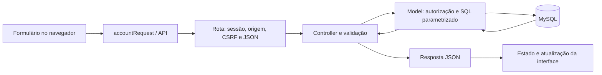
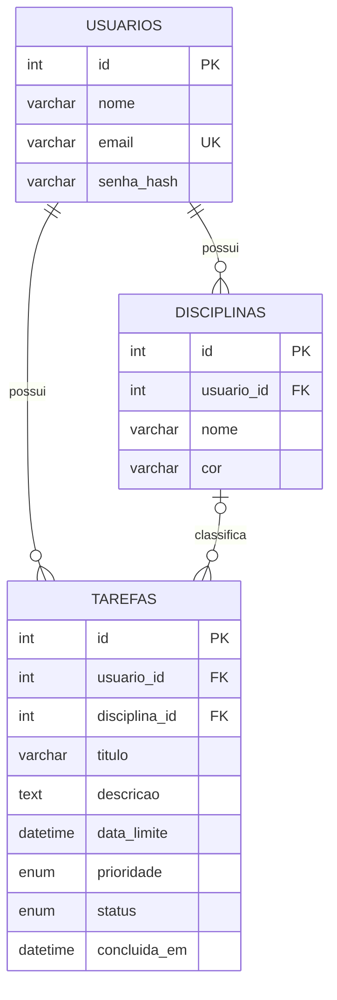
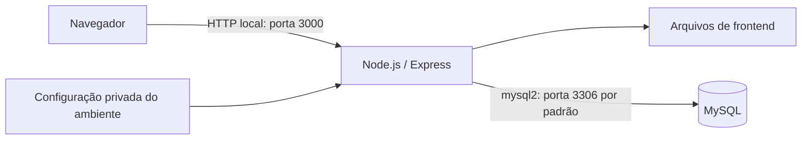
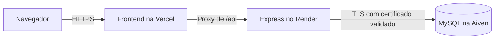

# StudyUp — guia de apresentação da equipe

Preparado em **05/11/2026**, para apresentação em **06/11/2026**. Análise baseada no código deste workspace, no esquema SQL, nos testes executados e nos registros existentes. A divisão abaixo segue a orientação atual da equipe, substituindo a divisão de apresentação sugerida no plano antigo.

**Como usar:** cada integrante estuda sua seção e os arquivos indicados. O [roteiro resumido](roteiro-apresentacao.md) serve para distribuir as responsabilidades e ensaiar. As falas são sugestões para adaptar à linguagem de cada pessoa; atribuem temas de apresentação, sem presumir autoria individual de cada linha de código.

## 1. Visão geral e resultado da análise

O StudyUp é um sistema web de organização de estudos. O núcleo permite criar uma conta, entrar, cadastrar disciplinas e organizar tarefas com prazo, prioridade e conclusão. Início, Tarefas e Agenda diária apresentam os dados da conta autenticada.

A implementação usa HTML, CSS e JavaScript no navegador; Node.js com Express no servidor; MySQL para persistência. É uma aplicação com responsabilidades separadas em camadas. Não usa React, ORM ou um processo de compilação do frontend. Os módulos JavaScript são carregados diretamente pelo navegador.

| Situação | Recursos |
| --- | --- |
| Implementados com backend/MySQL | Cadastro, login/logout, identificação da conta, disciplinas, tarefas, edição, exclusão, conclusão/reabertura, persistência e isolamento por usuário |
| Interface conectada aos dados reais | Início, lista de tarefas, adicionar/editar, filtros, contadores e agenda diária |
| Demonstração em memória | Projetos com checklist, notificações e preferências demonstrativas; os exemplos são recriados ao recarregar |
| Ainda pendentes | Recuperação de senha, login com Google, edição do perfil, notificações reais e agenda semanal/mensal |
| Infraestrutura confirmada nesta análise | Ambiente local; conexão MySQL e presença das três tabelas verificadas |
| Infraestrutura planejada no repositório | Vercel para frontend, Render para backend e Aiven para MySQL; adaptações e publicação não comprovadas como concluídas |

**Conclusão técnica:** o núcleo acadêmico está integrado e tem validação, autenticação, autorização, persistência e testes. A separação do código favorece manutenção. A preparação para publicação externa ainda exige trabalho, especialmente em sessões, HTTPS/proxy e conexão segura ao banco remoto.

### Evidências verificadas nesta preparação

| Verificação | Resultado | Alcance |
| --- | --- | --- |
| `npm test` | **54 testes aprovados**, zero falhas, cancelamentos ou ignorados | Suíte versionada, incluindo HTTP local e dependências controladas; não equivale a testar todo o MySQL real ou todos os navegadores |
| `npm run db:check` | Conexão OK; `usuarios`, `disciplinas`, `tarefas` encontradas | Leitura de conectividade e existência; não testa cada constraint nem backup/restauração |
| Permissões locais | `env/`: 0700; `env/.env`: 0600 | Metadados conferidos sem mostrar credenciais |
| Versionamento | `env/.env` não rastreado; regras de exclusão presentes | Não foi repetida nesta preparação a varredura completa de segredos do histórico |
| Código | Rotas, controllers, models, validadores, segurança, esquema e módulos centrais da interface analisados | Inspeção estática e execução da suíte existente |

A primeira execução de testes encontrou restrição do ambiente para abrir sockets locais (`EPERM`). A execução com permissão adequada passou integralmente; não foi necessário modificar o sistema.

Os registros de [segurança](seguranca.md) e do [plano MVP](plano-mvp.md) relatam testes anteriores com MySQL real e Chrome. Esses resultados históricos são identificados como registros anteriores neste documento; não foram repetidos no navegador nesta preparação.

## 2. Divisão e ordem da apresentação

Sugestão de **20 minutos**, incluindo demonstração. Ajustar ao tempo dado pelo professor.

| Ordem | Responsável | Tempo | Tema e material para mostrar |
| --- | --- | --- | --- |
| 1 | Laura | 3 min | Objetivo, escopo, estrutura geral e pastas do frontend |
| 2 | Ícaro | 5 min | Pastas do backend, blocos essenciais e segurança final, incluindo `.env` e injeção SQL |
| 3 | Erica | 3 min | Design, identidade visual, usabilidade e QA |
| 4 | Lucas | 3 min | Tabelas, relacionamentos, persistência, consultas e integridade |
| 5 | Iasmin | 3 min | Infraestrutura local, inicialização e plano de deploy |
| 6 | Equipe | 3 min | Demonstração integrada e encerramento |

Laura explica a organização do projeto e da interface. Ícaro aprofunda a organização do servidor e o caminho de uma operação. Lucas aprofunda a parte de dados desse mesmo caminho. Assim cada pessoa complementa a anterior.

## 3. Laura — estrutura de pastas e sua importância

### Mensagem principal

> “O StudyUp ajuda o estudante a organizar disciplinas, tarefas e prazos. Dividimos o projeto em frontend, backend e documentação para deixar clara a responsabilidade de cada parte. Essa organização facilita encontrar arquivos, corrigir problemas e trabalhar em equipe.”

### Árvore para apresentar

```text
StudyUp/
├── frontend/                  # única pasta publicada pelo Express
│   ├── index.html             # entrada e marca
│   ├── views/pages/           # landing.html, auth.html e app.html
│   └── src/
│       ├── css/
│       │   ├── base/          # cores, tipografia, reset e regras gerais
│       │   ├── components/    # botões e menu reutilizáveis
│       │   ├── layouts/       # estrutura visual compartilhada
│       │   ├── pages/         # estilos específicos das telas
│       │   └── main.css       # ponto de entrada dos estilos
│       └── js/
│           ├── components/   # sessão da conta e menu
│           ├── layouts/      # inicialização e navegação da aplicação
│           ├── models/       # estado, adaptação e acesso à API
│           └── pages/        # comportamento de cada tela
├── backend/
│   ├── app.js                 # configura Express e middlewares
│   ├── server.js              # abre a porta e encerra recursos
│   ├── routes/                # endereços e proteções das operações
│   ├── controllers/           # coordenação e respostas HTTP
│   ├── models/                # consultas SQL e persistência
│   ├── validators/            # conferência de dados recebidos
│   ├── security/              # senha, sessão, CSRF e limites
│   ├── config/                # conexão e pool MySQL
│   ├── database/              # esquema SQL e instruções
│   ├── scripts/               # preparação e verificação do banco
│   ├── utils/                 # tratamento de datas
│   └── tests/                 # testes automatizados
├── docs/                      # decisões, planos e apresentação
├── env/                       # configuração local privada
├── .env.example               # modelo sem credenciais reais
├── .gitignore                 # exclusões do versionamento
├── package.json               # dependências e comandos
└── package-lock.json          # versões resolvidas das dependências
```

`node_modules/` contém dependências instaladas pelo npm; não é código desenvolvido pela equipe e não deve entrar na apresentação de arquivos próprios.

### Por que essa estrutura importa

| Decisão | Benefício concreto |
| --- | --- |
| Separar frontend e backend | A interface não precisa conhecer credenciais nem escrever SQL; a autorização fica no servidor |
| Servir apenas `frontend/` | O navegador não recebe os arquivos do servidor, do Git ou de configuração privada |
| CSS de base, componente e página | Uma mudança de cor pode ser centralizada; um ajuste de tela fica mais localizado |
| JavaScript dividido por responsabilidade | O menu e a sessão são compartilhados; cada tela mantém seu comportamento específico |
| Testes separados | Permite verificar mudanças sem misturar testes ao código da aplicação |
| Documentação e exemplos de configuração | Facilita outra pessoa entender e preparar o ambiente |

**Exemplo para falar:** “Se precisarmos alterar a cor principal, começamos em `variables.css`. Se uma tarefa não estiver sendo salva, seguimos a página, a chamada à API e as camadas do backend. Sabemos onde procurar.”

### Blocos essenciais da interface

- `frontend/views/pages/app.html`: contém os painéis da área interna; a navegação por `#inicio`, `#tarefas` etc. alterna painéis da mesma página.
- `frontend/src/js/layouts/app-layout.js`: confirma a conta antes de montar as telas, controla navegação, carregamento e erros.
- `frontend/src/js/components/account-session.js`: consulta `/api/auth/me`, mantém o token CSRF em memória, faz chamadas autenticadas e trata expiração/logout.
- `frontend/src/js/models/task-store.js`: compartilha tarefas e disciplinas entre telas e evita que leituras antigas sobrescrevam gravações recentes.

Os `models` do frontend organizam dados da interface e acesso à API. Os `models` do backend acessam MySQL. O nome parecido não significa que o navegador se conecte ao banco.

**O que mostrar:** árvore de pastas no editor, `main.css` e imports de `app-layout.js`. Evitar percorrer todos os arquivos.

**Transição:** “Essa organização também aparece no servidor. O Ícaro vai mostrar como um pedido percorre essas camadas e quais proteções foram implementadas.”

## 4. Ícaro — backend, blocos essenciais e segurança

### Como uma tarefa é salva



> “Quando o usuário salva uma tarefa, a tela envia dados para a API. A rota verifica a sessão e as proteções da requisição. O controller valida os campos e chama o model, que faz a gravação no MySQL. A interface só confirma o resultado depois da resposta do servidor.”

### Blocos indispensáveis e consequências de sua ausência

| Bloco | Arquivos principais | Por que é essencial |
| --- | --- | --- |
| Inicialização | `server.js`, `app.js` | Sem eles não há servidor ouvindo nem ligação entre frontend e APIs |
| Rotas | `routes/*-routes.js` | Conectam URLs às operações e aplicam proteções antes do processamento |
| Controllers | `controllers/*-controller.js` | Coordenam validação, persistência e resposta; convertem falhas em mensagens adequadas |
| Validação | `validators/` | Impede dados inválidos, campos extras e identificadores incorretos nas operações protegidas |
| Autenticação e sessão | `auth-controller.js`, `security/session.js` | Identificam quem está usando a aplicação e impedem acesso sem login |
| Models e conexão | `models/`, `config/database.js` | Guardam e recuperam os dados; sem persistência o núcleo não mantém contas e tarefas |
| Datas | `utils/task-dates.js` | Define prazo/atraso usando o horário de Fortaleza e rejeita datas inexistentes |

Separar `createApp()` de `server.js` também permite testar o aplicativo com dependências controladas e portas temporárias. Os testes conseguem simular banco indisponível e verificar respostas sem usar contas reais.

### Segurança final: proteção do `.env`

O registro da revisão final documenta a mudança da configuração para `env/.env`. O código atual carrega esse caminho nos comandos `start`, `dev` e `db:check`.

1. `env/.env` reúne a configuração privada local; as credenciais não ficam no JavaScript do navegador.
2. `.gitignore` ignora toda a pasta `env/` e arquivos `.env`, preservando o exemplo público.
3. A pasta tem permissão **0700**: acesso restrito ao proprietário. O arquivo tem **0600**: leitura e escrita pelo proprietário.
4. O Express serve somente `frontend/`; mover o arquivo é uma camada adicional à separação da pasta pública.
5. `.env.example` orienta a configuração sem distribuir a senha real.
6. O instalador recusa sobrescrever uma configuração existente, incluindo o antigo `.env` na raiz.

**Fala sugerida:** “Na revisão final, protegi as credenciais em `env/.env`, fora da pasta pública e do versionamento. Também restringi o acesso ao arquivo no sistema operacional e mantive apenas um exemplo sem senha no repositório. Mudar a pasta não criptografa o arquivo; a proteção depende dessas medidas em conjunto.”

**Mostrar:** `.gitignore`, `.env.example` e a configuração de `express.static` em `app.js`. **Não abrir o arquivo real `env/.env` no projetor.**

### Segurança final: prevenção de injeção SQL no MySQL

Injeção SQL ocorre quando uma entrada consegue alterar a estrutura de um comando SQL. Nos models, os valores são passados separadamente ao método `execute`, com placeholders `?`.

Exemplo real simplificado de `user-model.js`:

```js
const [rows] = await database.execute(
  'SELECT id, nome AS name, email, senha_hash AS passwordHash FROM usuarios WHERE email = ? LIMIT 1',
  [email],
);
```

**Explicação:** “O comando tem uma estrutura definida. O e-mail entra como valor do parâmetro, e não como trecho do SQL. Por isso, um texto parecido com SQL não passa a comandar a consulta.”

Proteções complementares:

- `multipleStatements: false` desativa múltiplos comandos em uma chamada; é defesa adicional, não substitui parametrização.
- A edição dinâmica de disciplinas escolhe colunas de uma lista fixa; o usuário não fornece nomes arbitrários de colunas.
- Validadores conferem tipos, tamanhos, IDs, estados, prioridades e datas.
- O instalador concede ao usuário da aplicação apenas `SELECT`, `INSERT`, `UPDATE` e `DELETE` no banco StudyUp; o registro anterior relata confirmação desses privilégios no banco real.
- As respostas de falha dos controllers não devolvem SQL ou credenciais.

O SQL administrativo do instalador usa uma senha aleatória gerada internamente em formato controlado; ele é um fluxo local de configuração, separado das consultas que recebem dados HTTP.

**Registro da revisão anterior:** entrada de SQL em login recebeu 401, ID manipulado recebeu 400 e texto semelhante a SQL foi armazenado literalmente em tarefa fictícia. Referência: [seguranca.md](seguranca.md). Isso comprova os cenários registrados, não uma garantia absoluta contra qualquer ataque.

### Outras medidas que Ícaro deve explicar

| Medida | Implementação e objetivo |
| --- | --- |
| Hash de senha | **scrypt**, com salt aleatório por senha e comparação com `timingSafeEqual`; não é bcrypt nem criptografia reversível |
| Sessão | Cookie `studyup.sid`, `HttpOnly`, `SameSite=Lax`, `secure: 'auto'` e duração máxima de duas horas; ID renovado no login e invalidado no logout |
| Autorização por dono | `userId` vem da sessão; consultas restringem `usuario_id`. Saber o ID de uma tarefa não autoriza acessá-la |
| CSRF | Escritas autenticadas exigem token `X-CSRF-Token`; requisições de origem externa são rejeitadas pela verificação de origem |
| Limite de tentativas | Cadastro: cinco por IP em quinze minutos; login: dez. Há limite de duas operações simultâneas por controller para processamento caro |
| Limite de corpo | JSON de até 8 KiB para cadastro/login/disciplinas e 40 KiB para tarefas |
| Renderização de dados | Módulos revisados usam `textContent` e criação de elementos para dados dinâmicos, reduzindo risco de executar marcação enviada pelo usuário |
| Cache | Respostas autenticadas usam `no-store` para evitar reutilização de dados privados |

No cadastro, a senha deve ter de 15 a 128 caracteres, com confirmação. Pode ser uma frase; não há obrigação de um padrão arbitrário de símbolos.

**Fala de fechamento:** “A segurança envolve autenticar, conferir a quem o dado pertence, validar a entrada e proteger a consulta. Na revisão final também foi acrescentado o limite temporal de cadastro, além do limite de processamento simultâneo que já existia.”

**Limites conhecidos:** sessões e contadores ficam na memória de um processo; reiniciar encerra sessões e zera contadores. Não há CSP, quotas gerais de registros ou paginação. HTTPS e configuração de proxy precisam ser preparados para publicação. Não apresentar o sistema como imune a ataques ou pronto para produção em escala.

**Transição:** “Com esse funcionamento e essas proteções, a Erica vai explicar como a interface comunica as ações e como a qualidade foi verificada.”

## 5. Erica — design, identidade visual e QA

### Identidade visual

| Elemento observado | Onde aparece | Como explicar |
| --- | --- | --- |
| Verde `#1b8963` | Cor principal em `variables.css` | Destaque recorrente de ações e identidade |
| Dourado `#e6ad13` | Cor de acento e marca | Complementa o verde e destaca a marca |
| Branco `#ffffff` | Fundo e superfícies | Base visual clara |
| Texto `#252a3b` | Cor principal de texto | Diferencia conteúdo do fundo |
| Tipografia | Família `Inter, sans-serif` | Aparência consistente; a fonte disponível depende do carregamento da página |
| Marca | Chapéu de formatura, sinal de mais e “StudyUp” | Pode ser apresentada como referência à educação e à evolução dos estudos |
| Componentes | Botões, cartões, bordas arredondadas e espaçamentos | Repetição visual ajuda a reconhecer ações semelhantes |

A entrada e a landing carregam Inter pelo Google Fonts; telas sem esse carregamento dependem da disponibilidade da fonte ou do fallback. Não afirmar que todas as telas usam exclusivamente fonte local ou que a tipografia é idêntica sem internet.

As associações de “evolução”, “clareza” e “organização” são uma leitura para comunicar o design observado; não há pesquisa de marca ou entrevistas com usuários comprovadas nesta análise.

**Fala sugerida:** “A identidade combina verde nas ações, dourado na marca e uma base clara. Repetimos cores, espaços e componentes para que as telas pareçam parte do mesmo sistema. A proposta é tornar tarefas, prazos e prioridades fáceis de localizar.”

### Usabilidade e acessibilidade

- Layout adaptável, navegação inferior e menu Mais; conteúdo com largura limitada em telas grandes.
- Campos com rótulos, feedback de erro e estados de carregamento, falha e nova tentativa.
- Foco visível, indicação da página atual e link para pular ao conteúdo.
- Exclusão com confirmação, conclusão/reabertura e filtros para localizar atividades.
- Estrutura de CSS com tokens compartilhados; ajustes visuais não precisam ser repetidos em cada tela.

Mostrar uma tarefa pendente, uma concluída, os filtros e uma mensagem de formulário. A existência dessas medidas não comprova conformidade completa de acessibilidade: contraste, leitor de tela e uso em aparelho real ainda merecem validação específica.

### Teste e QA

**Teste** verifica comportamentos. **QA** organiza critérios de qualidade, casos, evidências, registro de defeitos e reteste. A Erica pode apresentar esse processo sem atribuir a si testes que não executou pessoalmente.

| Camada | O que a equipe consegue explicar | Evidência |
| --- | --- | --- |
| Testes automatizados | Validação, cadastro, login, sessão, CSRF, autorização, tarefas, disciplinas e consistência do estado | 54 testes da suíte passaram nesta preparação |
| Banco real | Conexão e existência das três tabelas | `npm run db:check` passou nesta preparação |
| Integração anterior | CRUD, isolamento, rollback, concorrência e persistência | Registro de 05/11 no plano MVP e em segurança |
| Navegador anterior | 25 verificações integradas e 36 combinações de telas/larguras, além de cenários específicos | Registro no plano MVP; não confundir com os 54 testes automatizados |
| Verificação ainda necessária | Celular físico, teclado virtual, rede da apresentação, backup/restauração e deploy | Checklist de ensaio abaixo |

**Fala sugerida:** “A qualidade foi verificada em diferentes camadas. A suíte automatizada passou em 54 testes e inclui caminhos de sucesso e de erro. Também existem registros de integração e responsividade no navegador. Isso não substitui testar no equipamento e na rede que vamos usar na apresentação.”

### Matriz para o ensaio da Erica

Preencher após executar; os campos vazios não representam aprovação.

| Caso | Resultado esperado | Resultado / evidência |
| --- | --- | --- |
| Entrar sem autenticação na área interna | Redirecionar para login | A preencher |
| Cadastrar/entrar com conta fictícia | Conta criada e nome exibido | A preencher |
| Criar disciplina e tarefa | Aparecer na lista, Início e agenda do prazo | A preencher |
| Editar, concluir e reabrir | Campos e contadores atualizados | A preencher |
| Recarregar e entrar novamente | Dados persistirem | A preencher |
| Segunda conta em janela anônima | Não visualizar os dados da primeira | A preencher |
| Excluir disciplina vinculada | Bloqueio com mensagem clara | A preencher |
| Teclado, menu, zoom e tela estreita | Ações alcançáveis e foco perceptível | A preencher |
| Logout | Área interna voltar a exigir login | A preencher |

Ao encontrar um problema, registrar passos, resultado esperado, resultado obtido, aparelho/navegador e evidência. Prioridade: vazamento/perda de dados e falha de login/salvamento; depois problemas de uso; por último acabamento visual.

**Transição:** “A interface mostra o resultado das operações. O Lucas vai explicar como esses dados ficam organizados e protegidos no banco.”

## 6. Lucas — banco de dados e persistência

### Modelo de dados real

O esquema em `backend/database/schema.sql` define MySQL, engine InnoDB, charset `utf8mb4` e três tabelas de negócio. O script foi preparado para MySQL 8.4; o comando de verificação executado nesta preparação não consultou a versão instalada.



O desenho resume os campos principais; foto e campos de auditoria constam do esquema completo. Uma tarefa pode existir sem disciplina. O vínculo com uma disciplina precisa pertencer ao mesmo usuário.

| Tabela | Responsabilidade | Regras importantes |
| --- | --- | --- |
| `usuarios` | Identidade da conta | ID primário, e-mail único, nome não vazio e hash da senha |
| `disciplinas` | Matérias organizadas por conta | Nome único por usuário; duas contas podem usar o mesmo nome |
| `tarefas` | Atividade e seu acompanhamento | Dono obrigatório, disciplina opcional, título e prazo obrigatórios, prioridade e estado controlados |

### Relacionamentos e integridade

- **Chave primária:** identifica cada registro por ID.
- **Chave estrangeira:** exige que referências apontem para registros existentes.
- **Chave estrangeira composta:** `(usuario_id, disciplina_id)` de tarefas referencia `(usuario_id, id)` de disciplinas; protege também a correspondência do dono.
- **`ON DELETE RESTRICT`:** impede exclusão que deixaria referências inválidas. Para apagar uma disciplina usada, primeiro alterar/remover os vínculos das tarefas.
- **`CHECK`:** título/nome não vazios; tarefa pendente tem `concluida_em` nulo, concluída tem data preenchida.
- **Índices:** auxiliam consultas por usuário e prazo e relações entre tarefas e disciplinas.

**Fala sugerida:** “Cada usuário possui suas disciplinas e tarefas. Além de o servidor filtrar pelo usuário da sessão, o banco impede que uma tarefa seja vinculada a uma disciplina de outra conta. São proteções complementares: uma atua na consulta, a outra na integridade dos registros.”

### Como o backend conversa com o banco

O navegador chama a API; somente o backend usa `mysql2/promise`. A configuração mantém um pool com até cinco conexões, fila limitada a vinte e timeout de conexão de cinco segundos. Reutilizar conexões evita abrir uma nova conexão para cada operação.

Os models fazem `INSERT`, `SELECT`, `UPDATE` e `DELETE`. A listagem de tarefas usa `LEFT JOIN` para incluir o nome da disciplina sem descartar tarefas sem disciplina. A lista de disciplinas calcula a quantidade de tarefas pendentes de cada uma.

Criação e edição de tarefas usam transação:

1. Obter uma conexão e iniciar a transação.
2. Conferir o vínculo com a disciplina e executar a operação.
3. Confirmar com `commit` se tudo der certo.
4. Reverter com `rollback` se houver erro.
5. Liberar a conexão para o pool.

A edição também usa `SELECT ... FOR UPDATE`, bloqueando a linha durante a transação para preservar alterações concorrentes em campos omitidos. Nem toda operação do projeto utiliza uma transação explícita; o destaque se aplica à criação/edição de tarefas.

### Datas, estados e persistência

- `data_limite` e `concluida_em` usam `DATETIME`, tratados como horário civil de Fortaleza. `dateStrings: true` evita conversão automática pelo driver.
- Campos de auditoria usam `TIMESTAMP`; sua apresentação depende do fuso da sessão MySQL.
- O banco armazena os estados `pendente` e `concluida`. **Atrasada é uma condição calculada:** pendente com prazo anterior ao horário atual.
- Concluir preenche a data; repetir conclusão preserva a primeira data; reabrir limpa a data de conclusão.
- Recarregar a página não apaga contas, disciplinas e tarefas persistidas. Projetos/notificações demonstrativos são outra categoria e ficam em memória do navegador.
- Sessões atualmente ficam na memória do servidor, **não em uma quarta tabela de sessões**. Reiniciar Node pede novo login, mas não apaga os dados do MySQL.

**Mostrar:** diagrama, partes de `schema.sql` e uma tarefa persistindo após recarga. Se mostrar consulta ao banco, usar apenas dados fictícios e selecionar campos como ID/título/estado; não projetar `senha_hash` ou credenciais.

**Cuidado operacional:** `CREATE TABLE IF NOT EXISTS` cria o que falta, mas não atualiza tabelas antigas. Migrações e backup/restauração devem ser tratados explicitamente. Não executar `db:setup` novamente no banco já configurado durante a apresentação.

**Transição:** “O banco é um serviço separado do Node. A Iasmin vai mostrar como esses serviços são executados e como está planejada a publicação.”

## 7. Iasmin — infraestrutura e deploy

### Arquitetura local atual



O mesmo Express entrega HTML/CSS/JS e atende `/api`. Por isso as chamadas do frontend podem usar caminhos relativos, como `/api/tarefas`. MySQL é outro processo. Não há evidência de Docker, Kubernetes ou pipeline CI/CD configurado no repositório analisado.

### Componentes e execução

| Item | Estado atual |
| --- | --- |
| Runtime | Node.js 24 ou superior; análise executada com 24.18.0 |
| Dependências diretas declaradas | Express 5.2.1, express-session 1.19.0, mysql2 3.24.6 |
| Instalação reproduzível | `npm ci`, usando `package-lock.json` |
| Início | `npm start` carrega `env/.env`, quando existente, e inicia `backend/server.js` |
| Desenvolvimento | `npm run dev` ativa observação de alterações |
| Host/porta padrão | `127.0.0.1:3000`; configuráveis por `HOST` e `PORT` |
| Testes | `npm test` |
| Verificação do banco | `npm run db:check` |
| Encerramento | `SIGINT`/`SIGTERM` fecham o servidor e o pool |

**Fala sugerida:** “Infraestrutura é o ambiente necessário para o sistema funcionar: runtime, servidor web, banco, configuração e rede. Hoje o Node entrega a interface e a API localmente, e o MySQL mantém os dados. Deploy é preparar e publicar esses componentes em um ambiente acessível aos usuários.”

Na máquina já configurada, antes da apresentação:

```sh
npm run db:check
npm test
npm start
```

Abrir `http://127.0.0.1:3000`. Se já houver servidor na porta, verificar o processo existente antes de tentar iniciar outro. Um celular não acessa o servidor do computador pelo próprio `127.0.0.1`; o acesso em outro dispositivo requer configuração de rede apropriada e validação prévia.

### Diagnóstico com `/api/status`

| Banco informado | HTTP | Interpretação |
| --- | --- | --- |
| `connected` | 200 | `SELECT 1` funcionou; não comprova todas as tabelas ou operações |
| `not_configured` | 200 | Não há configuração completa iniciada; a API de status ainda responde |
| `unavailable` | 503 | Banco/configuração indisponível; aplicação informa `degraded` |

Para a demonstração funcional, conferir **`database: connected`** e executar `db:check`; apenas receber HTTP 200 não é suficiente.

### Deploy planejado — ainda não apresentado como entregue

O [plano de hospedagem](plano-hospedagem.md) propõe:



Esses provedores são os nomes escolhidos no plano existente; disponibilidade de planos, quotas e condições não foi revalidada nesta análise e não deve ser tratada como garantia comercial.

**Etapas técnicas pendentes antes de considerar o deploy pronto:**

1. Suportar TLS e CA validada na conexão MySQL remota; o código atual não configura esse TLS.
2. Usar segredo de sessão estável do ambiente e armazenamento persistente de sessões; hoje o segredo é aleatório por instância e o store é em memória.
3. Configurar proxy, origem permitida, cookies HTTPS e encaminhamento `/api`, preservando CSRF e identificação confiável de IP.
4. Definir host de escuta externo, porta do provedor e variáveis privadas no backend.
5. Preparar banco remoto compatível, usuário restrito e procedimento de backup/restauração.
6. Validar reinício, retomada de serviço, timeout, limites de requisições e fluxo completo pela URL pública.

`SESSION_SECRET` e `APP_ORIGIN` aparecem como propostas no plano, mas **ainda não são consumidos pelo código atual**. Criar essas variáveis sem adaptar o código não implementa a funcionalidade.

**Fala sugerida:** “A execução local está funcional. O deploy está planejado com separação entre frontend, backend e banco. Ainda precisamos adaptar sessão, conexão TLS, proxy e cookies e validar a URL pública. Por isso distinguimos a infraestrutura funcionando hoje da publicação planejada.”

Se a equipe publicar depois deste documento, atualizar esta seção com URL real, data e evidências de login, persistência, HTTPS e isolamento. Uma resposta do site institucional de um provedor não comprova que o StudyUp esteja hospedado nele.

## 8. Demonstração conjunta — aproximadamente três minutos

Preparar duas contas fictícias antes da aula para não consumir tentativas de cadastro ao vivo. Combinar quem opera o computador e evitar trocas demoradas.

| Momento | Operação | Quem explica |
| --- | --- | --- |
| 0:00–0:25 | Entrada e login com conta preparada | Laura contextualiza; Erica aponta consistência visual |
| 0:25–1:05 | Criar disciplina “Desenvolvimento Web” e tarefa “Revisar apresentação” | Ícaro explica chamada à API; Lucas aponta o vínculo |
| 1:05–1:35 | Editar, concluir/reabrir e filtrar | Erica explica feedback e critérios de teste |
| 1:35–2:00 | Recarregar e mostrar tarefa mantida | Lucas explica persistência |
| 2:00–2:25 | Abrir segunda conta em janela anônima | Ícaro explica isolamento por sessão |
| 2:25–2:45 | Mostrar status com banco conectado | Iasmin explica comunicação dos serviços |
| 2:45–3:00 | Resumir núcleo entregue e próximas etapas | Laura encerra |

Para aparecer na agenda diária de amanhã, usar prazo em **06/11/2026**, com horário escolhido conforme o momento do ensaio/apresentação, sempre em Fortaleza. Uma tarefa pendente com horário já vencido aparecerá como atrasada.

Reservar prints ou vídeo do fluxo como apoio se houver falha de equipamento. Identificar a gravação como evidência anterior, caso seja usada. Projetos/notificações podem ser mostrados apenas com a explicação de que são demonstrativos.

## 9. Perguntas prováveis e respostas curtas

| Pergunta | Resposta |
| --- | --- |
| Por que separar pastas? | Para localizar responsabilidades, reutilizar componentes, testar e reduzir exposição acidental de arquivos privados. |
| O frontend se conecta ao MySQL? | Não. Ele chama a API, e o backend valida e acessa o banco. |
| A senha fica no `.env`? | A senha da conexão com o banco fica na configuração privada local. Senhas dos usuários ficam como hash scrypt no MySQL. |
| O sistema usa bcrypt? | Não; usa scrypt nativo de `node:crypto`, com salt aleatório. |
| O que impede injeção SQL? | Principalmente consultas parametrizadas; complementadas por validação, colunas permitidas e privilégios mínimos. |
| Basta esconder um botão para proteger um dado? | Não. A API precisa validar sessão e dono em toda operação protegida. |
| O que acontece ao reiniciar o servidor? | As sessões atuais terminam; contas, disciplinas e tarefas permanecem no banco. |
| Por que não consigo apagar uma disciplina? | Se houver tarefas vinculadas, a integridade referencial bloqueia a exclusão. |
| Atrasada é um terceiro estado no banco? | Não. É calculado a partir de estado pendente e prazo vencido. |
| Todos os testes usam MySQL real? | Não. A suíte usa também dependências controladas; testes reais anteriores e `db:check` são evidências distintas. |
| O sistema já está online? | A execução local foi confirmada. O repositório registra a publicação como planejada, sem deploy concluído comprovado nesta análise. |
| Está tudo pronto? | O núcleo de contas, disciplinas e tarefas está integrado; há recursos demonstrativos e preparação de produção pendente. |

## 10. Pontos de atenção encontrados na análise documental

Estes itens evitam falas contraditórias; não foram feitas alterações no código da aplicação nem nos registros históricos para produzir este material.

| Achado | Orientação para apresentação |
| --- | --- |
| `backend/database/README.md` ainda diz que não há cadastro real e que autorização será implementada | Usar este guia, o README principal e o código atual: cadastro e autorização já existem |
| `docs/plano-hospedagem.md`, seção H4, diz que status retorna 200 com banco indisponível | Código atual retorna 503 para `unavailable`; 200 com `not_configured` continua possível |
| Alguns guias iniciais descrevem arquitetura anterior | A árvore deste documento foi montada a partir dos arquivos atuais |
| Texto do cadastro ainda afirma que as atividades são exemplos | Distinguir tarefas reais de Projetos/Notificações demonstrativos ao explicar o produto |
| `authNavigation.js` está não rastreado e não integra o fluxo principal identificado | Não usá-lo como exemplo de navegação implementada; mostrar `app-layout.js` e os módulos efetivamente carregados |
| Registros de rodadas anteriores citam 50 testes | A suíte atual executada tem 54; números de navegador são verificações separadas |
| Documentos antigos usam “Iasmim” | Este material usa “Iasmin”, conforme a divisão solicitada agora |

### Checklist final da equipe

- [ ] Cada integrante revisou sua fala e sabe abrir os arquivos indicados.
- [ ] Tempo total ensaiado e ajustado ao limite do professor.
- [ ] Contas fictícias e prazo da tarefa preparados.
- [ ] MySQL e servidor testados no equipamento da apresentação.
- [ ] Erica registrou o resultado do ensaio e os problemas encontrados.
- [ ] Segredos e dados pessoais não aparecem em slides, capturas ou editor.
- [ ] Diagrama do banco e arquitetura disponíveis como apoio.
- [ ] Material reserva identificado como gravação/captura, se necessário.
- [ ] A equipe distingue recursos reais, demonstrativos e planejados.

## 11. Mapa de fontes para estudar

- Visão atual: [README principal](../README.md).
- Inicialização: [app.js](../backend/app.js), [server.js](../backend/server.js), [package.json](../package.json).
- Interface: [app-layout.js](../frontend/src/js/layouts/app-layout.js), [account-session.js](../frontend/src/js/components/account-session.js), [task-store.js](../frontend/src/js/models/task-store.js).
- Design: [variables.css](../frontend/src/css/base/variables.css), [main.css](../frontend/src/css/main.css), [página de entrada](../frontend/index.html).
- Segurança: [revisão registrada](seguranca.md), [sessão](../backend/security/session.js), [hash de senha](../backend/security/password.js), [limite de tentativas](../backend/security/attempt-limit.js).
- Banco: [schema.sql](../backend/database/schema.sql), [conexão](../backend/config/database.js), [model de tarefas](../backend/models/task-model.js), [model de disciplinas](../backend/models/subject-model.js), [model de usuários](../backend/models/user-model.js).
- QA: [testes versionados](../backend/tests/), [histórico de validação](plano-mvp.md).
- Infraestrutura futura: [plano de hospedagem](plano-hospedagem.md), observando as ressalvas deste guia.
