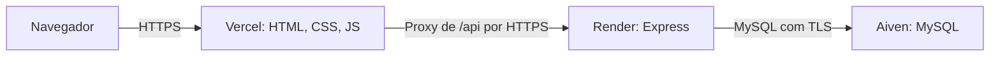

# StudyUp — plano de hospedagem gratuita

Consulta das condições: 05/11/2026. Plano proposto para demonstração escolar, sem contratação paga. A infraestrutura abaixo ainda não foi criada e os ajustes de produção ainda não foram implementados.

## 1. Onde colocar cada parte

| Parte | Serviço e plano | Configuração proposta |
| --- | --- | --- |
| Frontend | Vercel Hobby | Publicar somente `frontend/`, como site estático. |
| Backend | Render Web Service Free | Node.js 24, instalação `npm ci`, inicialização `npm start`, raiz do repositório. |
| Banco | Aiven for MySQL Free | Banco remoto persistente, conectado pelo backend com TLS e certificado validado. |

Condições verificadas nas fontes oficiais:

- [Vercel Hobby](https://vercel.com/docs/plans/hobby): destinado a uso pessoal não comercial, sujeito às quotas do plano. Confirmar elegibilidade da conta/repositório escolar e limites no painel.
- [Render Free](https://render.com/docs/free): suspende após 15 minutos sem tráfego; reativação pode levar cerca de um minuto. Disco local é efêmero. Horas, tráfego e builds têm limites; conferir saldo do workspace. Serve para demonstração, sem promessa de disponibilidade de produção.
- [Aiven MySQL Free](https://aiven.io/docs/products/mysql/concepts/mysql-free-tier): não exige cartão e não tem prazo fixo; inclui um nó, 1 GB de RAM, 1 GB de disco, backups e até 76 conexões. Não oferece VPC/SLA e pode suspender serviços inativos após aviso. Escolher Free, não avaliação temporária de plano pago.

Não ativar upgrades, discos pagos nem recursos adicionais pagos. Se um provedor não oferecer o plano gratuito para a conta, interromper essa escolha e revisar o plano. Domínios próprios não são necessários; usar os subdomínios gratuitos dos serviços.

## 2. Comunicação prevista

[Rewrites externos da Vercel](https://vercel.com/docs/routing/rewrites) permitem encaminhar `/api/:path*` para `https://SEU-BACKEND.onrender.com/api/:path*`. Isso mantém as chamadas relativas existentes e evita depender de cookies entre sites diferentes. O endereço é um exemplo; só configurar após obter a URL real.

Aiven e Render não compartilharão uma rede privada. Exigir validação de certificado TLS, restringir acesso aos endereços de saída do Render quando o plano/painel permitir e nunca usar `rejectUnauthorized: false`. Credenciais ficam somente no backend. HTML estático pode ser público: dados privados continuam protegidos pela sessão na API; o frontend já consulta `/api/auth/me`.

## 3. Etapas, em ordem

### H1 — preparar contas e escolher regiões (Ícaro; Laura registra evidências)

- [ ] Criar ou acessar Vercel, Render e Aiven, habilitando autenticação em dois fatores.
- [ ] Confirmar os planos gratuitos e o acesso ao repositório, sem publicar credenciais.
- [ ] Escolher regiões próximas entre Render e Aiven, conforme disponibilidade gratuita.
- [ ] Anotar apenas nomes dos serviços, regiões e URLs públicas. Senhas ficam nos painéis ou no arquivo local privado.

Pode começar por esta etapa. Não é necessário expor a API antes de concluir H2/H3.

### H2 — adaptar o código para hospedagem (Ícaro)

Apresentar cada alteração antes de implementar, mantendo o fluxo de aprendizado. Esta etapa ainda está pendente.

- [ ] `backend/config/database.js`: suportar TLS com CA validada, mantendo a conexão local funcional; testar certificado inválido e configuração incompleta.
- [ ] `backend/security/session.js`: ler `SESSION_SECRET` estável e secreto do ambiente; substituir MemoryStore por armazenamento de sessões no MySQL, com expiração e limpeza. Escolher e discutir a biblioteca antes de instalar. Criar migração para a tabela de sessões.
- [ ] `backend/security/json-request.js` e `backend/app.js`: validar origem por lista explícita do frontend e configurar confiança nos proxies Vercel/Render conforme o caminho real. Não usar confiança irrestrita em cabeçalhos enviados pelo cliente. Preservar CSRF.
- [ ] Cookies: exigir Secure em produção, manter HttpOnly, validar SameSite e funcionamento de Set-Cookie através do proxy; nunca compartilhar cache de respostas autenticadas.
- [ ] Limite de tentativas: confirmar IP real no caminho Vercel → Render, testar cabeçalho forjado e impedir acesso direto que contorne as regras. Persistir contadores para não perder o bloqueio quando o serviço gratuito dormir; discutir solução usando MySQL antes de implementar.
- [ ] Limitar abuso nas rotas autenticadas, paginação/quotas de registros e cabeçalhos contra incorporação indevida e execução de conteúdo inesperado.
- [ ] Tratar inicialização lenta: atualmente chamadas expiram em dez segundos. Mostrar estado de reconexão, permitir tentar novamente e testar eventual timeout do proxy. Não repetir automaticamente POST de cadastro/criação, pois a primeira tentativa pode ter sido processada.
- [ ] Configurar `HOST=0.0.0.0`, `NODE_ENV=production`, porta fornecida pelo Render e versão Node 24. Falhar claramente quando faltarem segredos/configurações obrigatórios.
- [ ] Criar configuração de rewrite da Vercel dentro de `frontend/`, mantendo API sem cache. Verificar páginas, assets e navegação por hash.
- [ ] Executar testes locais e simular o caminho por proxy antes de liberar acesso público.

Critério de saída: login funciona com HTTPS/proxy, sessões sobrevivem ao reinício, banco conecta com TLS válido e limites não dependem de confiar em IP arbitrário.

### H3 — criar e preparar o MySQL remoto (Ícaro)

- [ ] Criar MySQL Free na Aiven; guardar host, porta, banco, credenciais e CA no local apropriado.
- [ ] Verificar a versão MySQL disponível e compatibilidade com collation, CHECK e chaves estrangeiras do nosso esquema.
- [ ] Decidir o nome do banco: o esquema atual usa `CREATE DATABASE studyup` e `USE studyup`. Se o serviço fornecer outro banco ou restringir criação, preparar uma versão do script para esse banco. Não executar o instalador local com sudo na nuvem.
- [ ] Aplicar esquema e migração de sessões, criar usuário restrito para a aplicação quando permitido. Não usar a credencial administrativa no backend por conveniência.
- [ ] Carregar somente dados fictícios de demonstração. Não copiar contas pessoais sem necessidade.
- [ ] Testar backup e restauração em banco/ambiente de teste separado, sem sobrescrever o banco principal. Guardar exportações privadas fora do Git e do frontend.

### H4 — publicar backend no Render (Ícaro)

Após H2/H3, criar **Web Service → Node → Free** a partir do repositório.

| Campo | Valor |
| --- | --- |
| Root Directory | Raiz do repositório |
| Build Command | `npm ci` |
| Start Command | `npm start` |
| Health Check Path | `/api/status` — hoje retorna HTTP 200 mesmo se o banco estiver indisponível; conferir também `database: connected` ou implementar readiness adequado em H2. |
| Instance Type | Free |

Variáveis previstas (algumas precisam ser implementadas em H2):

| Variável | Uso |
| --- | --- |
| `NODE_ENV` | `production` |
| `HOST` | `0.0.0.0` |
| `PORT` | Usar a variável fornecida pelo Render |
| `DB_HOST`, `DB_PORT`, `DB_NAME` | Dados do MySQL remoto |
| `DB_USER`, `DB_PASSWORD` | Usuário restrito e senha, somente no painel do backend |
| `SESSION_SECRET` | Valor aleatório forte e estável; nunca enviar ao frontend |
| `APP_ORIGIN` | Nome proposto em H2 para a origem HTTPS exata da Vercel |
| Configuração TLS/CA | Definir nomes em H2 e cadastrar certificado/segredo pelo mecanismo suportado pelo Render |

Não enviar `env/.env`, não rodar `npm run db:setup` no build e não depender de arquivos locais para sessões ou banco. Registrar URL pública do backend e examinar logs sem expor credenciais.

### H5 — publicar frontend na Vercel (Ícaro; Laura valida navegação)

- [ ] Importar o repositório e selecionar **Root Directory: frontend** e preset **Other**.
- [ ] Usar publicação estática, sem etapa de compilação; confirmar que o diretório publicado é o conteúdo de `frontend/`.
- [ ] Configurar rewrite `/api/:path*` para a URL real do Render.
- [ ] Atualizar `APP_ORIGIN` no backend com a origem exata escolhida e republicar se necessário. URLs de preview não devem ser automaticamente confiadas por um curinga amplo.
- [ ] Não cadastrar senhas do MySQL na Vercel nem embuti-las no JavaScript.
- [ ] Conferir HTTPS, ausência de cache de dados privados e resposta 404 para caminhos de segredos.

### H6 — ensaio e aceite (Ícaro + Laura)

- [ ] Duas contas fictícias: cadastro, login, logout e isolamento de registros.
- [ ] Criar/editar/concluir/reabrir/excluir tarefa e conferir disciplinas, Início e Agenda.
- [ ] Reiniciar backend e verificar persistência de dados e sessão.
- [ ] Aguardar suspensão natural do Render e testar retomada, mensagem de espera e nova tentativa sem duplicação de gravações.
- [ ] Verificar bloqueio de cadastro por IP real e tentativas com IP forjado.
- [ ] Testar em celular físico e conexão diferente do computador de desenvolvimento.
- [ ] Confirmar backup restaurável, quotas gratuitas e nenhuma contratação paga.
- [ ] Registrar URLs, capturas e roteiro de apresentação; manter demonstração local de reserva.

Antes da aula, abrir e testar o sistema com antecedência para perceber suspensão ou indisponibilidade. Não criar tráfego artificial contínuo para contornar as regras gratuitas. Projetos/notificações permanecem exemplos e devem ser apresentados assim.

## 4. Divisão da equipe sem programação

Laura pode acompanhar planos/limites, preencher a matriz de testes, capturar evidências sem credenciais, revisar textos e ensaiar o fluxo. Ícaro fica com configuração técnica, TLS, sessões, banco, proxy e correções. O restante da equipe pode validar em aparelhos diferentes e preparar slides/roteiro, conforme o plano do MVP.

Nenhuma conta ou serviço externo foi criado por este planejamento. A sequência começa em H1; H2 é o próximo bloco de desenvolvimento, antes da publicação definitiva.
